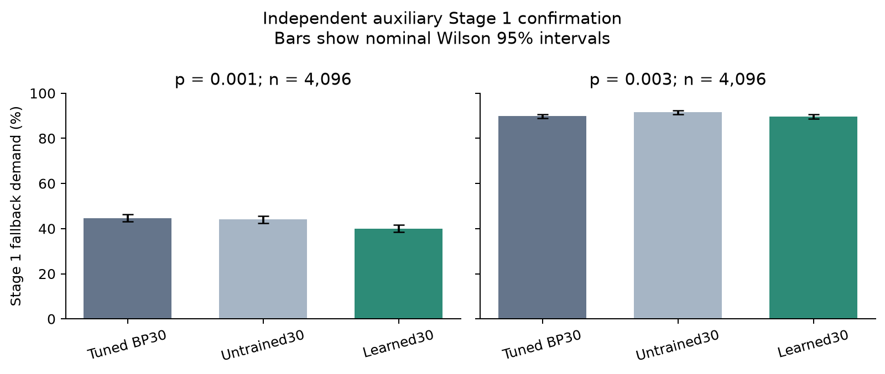

# CPU auxiliary learned-decoder assessment

This report separates fallback demand, logical accuracy and actual CPU latency. It is an auxiliary study; main M6/E1/E2 and M7 remain incomplete. Main final-test seeds are unused.

## Frozen method and independent Stage 1 result

A structural 15-step neural min-sum model (1,455 trainable parameters) received 4,000 updates on 32,000 unique BP15-rejected training cases at p=.001. Inference cycles the learned schedule for up to 30 iterations, with no extra training. The model and controls were frozen before drawing the 4,096 independent cases per noise point.

| Noise p | Tuned BP30 fallback | Matched initialization | Learned30 fallback | Primary Holm p |
|---|---:|---:|---:|---:|
| 0.001 | 1830/4096 (44.678%) | 1803/4096 (44.019%) | 1640/4096 (40.039%) | 1.74e-08 |
| 0.003 | 3680/4096 (89.844%) | 3751/4096 (91.577%) | 3671/4096 (89.624%) | 0.708 |

The declared screen returned **True**. The primary gain is concentrated at p=.001; the p=.003 comparison is inconclusive. Separate two-point learning comparisons use matched initialization. This result alone establishes neither equal logical error rate nor lower latency.

[Frozen confirmation evidence](../../m6_aux_confirmation/20261109T105342558744Z/summary.json)

## Remaining work

The original three-seed main E1 training/evaluation, full p grid, main E2 sample regime, ablations and scaling experiments remain pending. An auxiliary Stage 1 screen or a 512-shot timing pilot cannot mark M6 complete. No GPU or paid compute was used for this assessment.
