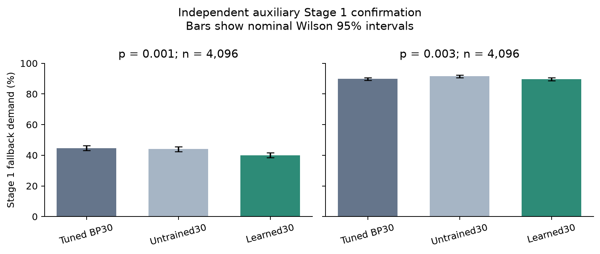
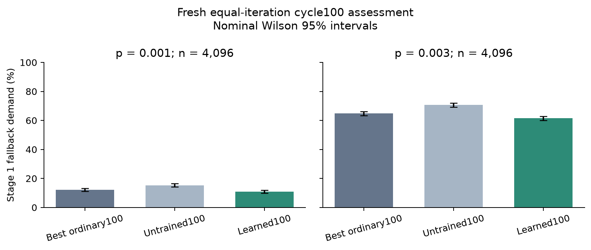

# CPU auxiliary learned-decoder assessment

This report separates fallback demand, logical accuracy and actual CPU latency. It is an auxiliary study; main M6/E1/E2 and M7 remain incomplete. Main final-test seeds are unused.

## Frozen method and independent Stage 1 result

A structural 15-step neural min-sum model (1,455 trainable parameters) received 4,000 updates on 32,000 unique BP15-rejected training cases at p=.001. Inference cycles the learned schedule for up to 30 iterations, with no extra training. The model and controls were frozen before drawing the 4,096 independent cases per noise point.

| Noise p | Tuned BP30 fallback | Matched initialization | Learned30 fallback | Primary Holm p |
|---|---:|---:|---:|---:|
| 0.001 | 1830/4096 (44.678%) | 1803/4096 (44.019%) | 1640/4096 (40.039%) | 1.74e-08 |
| 0.003 | 3680/4096 (89.844%) | 3751/4096 (91.577%) | 3671/4096 (89.624%) | 0.708 |

The declared screen returned **True**. The primary gain is concentrated at p=.001; the p=.003 comparison is inconclusive. Separate two-point learning comparisons use matched initialization. This result alone establishes neither equal logical error rate nor lower latency.

[Frozen confirmation evidence](../../m6_aux_confirmation/20261109T105342558744Z/summary.json)

## Training-seed robustness

The two additional seeds and final-step checkpoint rule were specified before primary confirmation. All seeds use the same confirmation cases; their shot counts must not be added as independent data.

| Training seed | Pool seed | p=.001 fallback | p=.003 fallback | Equal-point mean |
|---|---:|---:|---:|---:|
| 1234 (primary) | 52234 | 40.039% | 89.624% | 64.832% |
| 1235 | 68234 | 40.479% | 89.600% | 65.039% |
| 1236 | 69234 | 41.992% | 90.527% | 66.260% |

Across these three training seeds, equal-point mean fallback demand is 65.377% ± 0.772 percentage points (sample standard deviation). This is auxiliary method robustness, not completion of the original main training matrix.

## Fresh strong-first-pass cascade comparison

Extension of the approved BP-to-learned-to-OSD auxiliary family after observing that stronger ordinary BP dominates learned30. The learned parameters remain fixed. First BP100 factors come only from the existing validation sweep. Independently tune BP130 and BP100-to-BP30 on the same existing validation, freeze the best ordinary option including BP100 before fresh 74234/74235 cases. Primary two-point Holm family compares the fixed learned cascade with that validation-best ordinary option. A separate two-point family compares the matched initialization cascade. This is a new auxiliary study, not a replacement of the earlier primary or completion of main M6. Stage1 results do not establish equal LER or CPU latency.

The learned checkpoint is the unchanged primary checkpoint. Ordinary factors and the comparison pipeline were frozen before these new confirmation cases.

| p | BP100 | Best ordinary up to 130 | BP100 then learned30 | BP100 then untrained30 | Primary Holm p | Learning Holm p |
|---|---:|---:|---:|---:|---:|---:|
| 0.001 | 536/4096 | bp130: 410/4096 | 435/4096 | 455/4096 | 0.0474 | 0.0773 |
| 0.003 | 2650/4096 | bp130: 2390/4096 | 2591/4096 | 2610/4096 | 2.12e-34 | 0.0739 |

## Fixed-checkpoint longer-unroll validation

Original E5 motivates iteration generalization. Extend the same frozen learned 15-step schedule to 50 and 100 iterations, without new optimizer updates. Existing 42234/42235 validation only; no new independent confirmation, model replacement, LER or latency claim. Longer ordinary controls use their existing validation-selected factors. This auxiliary diagnostic is posthoc to the original 30-iteration confirmation and cannot change that result.

| p | Iteration cap | Learned failures | Same-T ordinary failures |
|---|---:|---:|---:|
| 0.001 | 50 | 237/1024 | 255/1024 |
| 0.001 | 100 | 110/1024 | 124/1024 |
| 0.003 | 50 | 815/1024 | 849/1024 |
| 0.003 | 100 | 617/1024 | 693/1024 |

## Independent equal-iteration cycle100 assessment

New auxiliary iteration-generalization study after validation-only evidence favored cycle100 over cycle50. No optimizer updates or source-weight replacement. Tune the native scalar100 implementation across all eleven factors on existing validation and compare the fixed learned100 with validation-best CPP100/native100. Freeze all controls and source checkpoints before fresh 80234/80235 cases. Primary and initialization comparisons each correct two noise points separately. Replication comparisons form separate four-test ordinary/initialization families; these checkpoints use fixed final step and cannot replace the primary. Main final tests are untouched. Stage1 assessment alone asserts no LER equivalence, latency improvement or main M6 completion.

This study keeps the original learned parameters and cycles the schedule to 100 inference iterations. Native scalar100 factors, ordinary comparison choices and all three source checkpoints were frozen before the new cases. Source weights have no additional optimizer updates.

| p | Best ordinary100 | Matched initialization100 | Learned100 seed1234 | Learned100 seed1235 | Learned100 seed1236 | Primary Holm p |
|---|---:|---:|---:|---:|---:|---:|
| 0.001 | cpp100: 495/4096 | 627/4096 | 443/4096 | 449/4096 | 467/4096 | 0.0217 |
| 0.003 | native100: 2654/4096 | 2892/4096 | 2518/4096 | 2478/4096 | 2545/4096 | 1.47e-05 |

Declared clear-gain screen: **True**. Equal-point mean fallback demand is 36.145% learned versus 38.440% best ordinary. Replication checkpoints share the same test cases; their shot counts are not independent extra cases.

## Secondary stronger iteration-budget challenge

This challenge was added after the primary result. T50/T100 factors are tuned on existing validation and frozen before their confirmation decoding. It does not replace the primary comparison.

| p | BP iterations | Validation-selected factor | Confirmation fallback demand |
|---|---:|---:|---:|
| 0.001 | 50 | 1 | 1138/4096 (27.783%) |
| 0.001 | 100 | 1 | 566/4096 (13.818%) |
| 0.003 | 50 | 0.95 | 3413/4096 (83.325%) |
| 0.003 | 100 | 1 | 2619/4096 (63.940%) |

## Remaining work

The original three-seed main E1 training/evaluation, full p grid, main E2 sample regime, ablations and scaling experiments remain pending. An auxiliary Stage 1 screen or a 256-shot timing pilot cannot mark M6 complete. No GPU or paid compute was used for this assessment.
