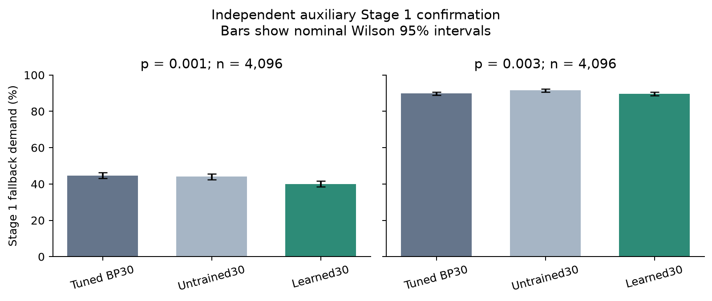
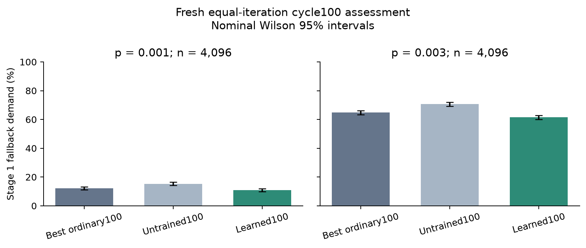
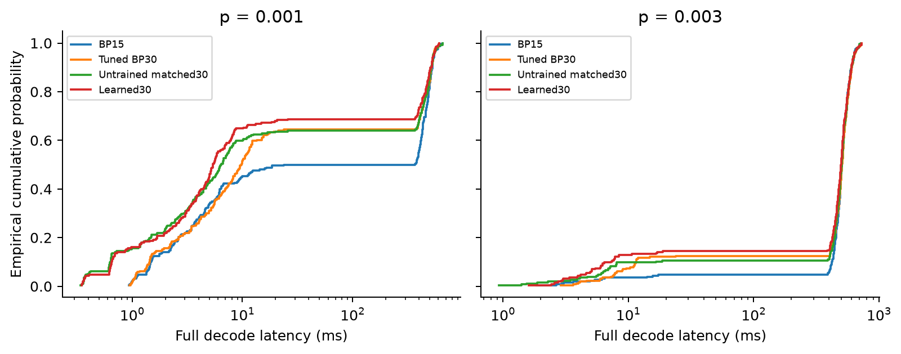
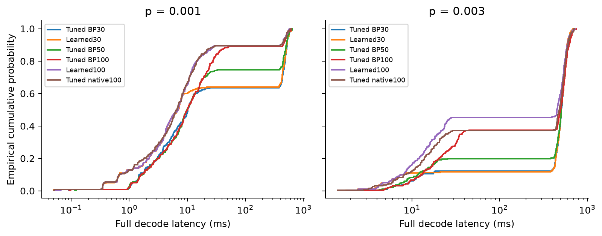
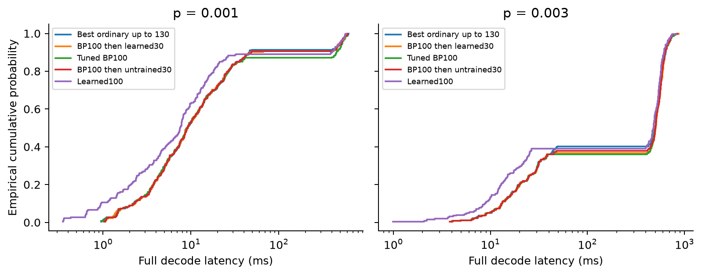

# CPU auxiliary learned-decoder assessment

This report separates fallback demand, logical accuracy and actual CPU latency. It is an auxiliary study; main M6/E1/E2 and M7 remain incomplete. Main final-test seeds are unused.

## Current finding

The fixed learned100 inference rule passed its independent Stage1 screen, with 2 corrected primary benefits across 2 noise points. It uses the original 1,455 learned source parameters and adds no optimizer updates. All three training seeds improved in direction; the per-seed corrected tests are reported below. 

| p | Validation-selected ordinary100 fallback | Learned100 fallback | Corrected primary p |
|---|---:|---:|---:|
| 0.001 | 495/4096 (12.08%) | 443/4096 (10.82%) | 0.0217 |
| 0.003 | 2654/4096 (64.79%) | 2518/4096 (61.47%) | 1.47e-05 |

The strong-first-pass cascade had more fallback requests than its ordinary control at both noise points. The timing pilots do not establish p99 superiority, and this report asserts no LER equivalence margin. The detailed accuracy, timing and negative controls follow below.

Cycle100 full-pipeline observed logical accuracy:

| p | Fixed target complete | Learned100 failures | Ordinary100 failures | Learned-only event upper bound |
|---|---|---:|---:|---:|
| 0.001 | True | 20/8192 | 24/8192 | 0.0991% |
| 0.003 | True | 177/1024 | 181/1024 | 1.7867% |

The event bounds are jointly one-sided at the declared family level; they do not assert a chosen equivalence margin.

The smaller fixed accuracy sample at p=0.003 recorded 661 learned versus 652 ordinary fallback requests. This fixed accuracy prefix contains the first 1,024 cases of the full 4,096-case Stage1 pool.

Observed CPU means in the 256-case longer-decoder pilot:

| p | CPP100 mean (ms) | Tuned native100 mean (ms) | Learned100 mean (ms) |
|---|---:|---:|---:|
| 0.001 | 66.740 | 58.550 | 58.347 |
| 0.003 | 354.723 | 343.666 | 301.031 |

These are pilot point estimates; paired intervals and the stronger BP130 comparison are reported below. No main E2/p99 acceptance is claimed.

## Frozen method and independent Stage 1 result

A structural 15-step neural min-sum model (1,455 trainable parameters) received 4,000 updates on 32,000 unique BP15-rejected training cases at p=.001. Inference cycles the learned schedule for up to 30 iterations, with no extra training. The model and controls were frozen before drawing the 4,096 independent cases per noise point.

| Noise p | Tuned BP30 fallback | Matched initialization | Learned30 fallback | Primary Holm p |
|---|---:|---:|---:|---:|
| 0.001 | 1830/4096 (44.678%) | 1803/4096 (44.019%) | 1640/4096 (40.039%) | 1.74e-08 |
| 0.003 | 3680/4096 (89.844%) | 3751/4096 (91.577%) | 3671/4096 (89.624%) | 0.708 |

The declared screen returned **True**. The primary gain is concentrated at p=.001; the p=.003 comparison is inconclusive. Separate two-point learning comparisons use matched initialization. This result alone establishes neither equal logical error rate nor lower latency.

[Frozen confirmation evidence](../../m6_aux_confirmation/20261109T105342558744Z/summary.json)

## Training-seed robustness

The two additional seeds and final-step checkpoint rule were specified before primary confirmation. All seeds use the same confirmation cases; their shot counts must not be added as independent data.

| Training seed | Pool seed | p=.001 fallback | p=.003 fallback | Equal-point mean |
|---|---:|---:|---:|---:|
| 1234 (primary) | 52234 | 40.039% | 89.624% | 64.832% |
| 1235 | 68234 | 40.479% | 89.600% | 65.039% |
| 1236 | 69234 | 41.992% | 90.527% | 66.260% |

Across these three training seeds, equal-point mean fallback demand is 65.377% ± 0.772 percentage points (sample standard deviation). This is auxiliary method robustness, not completion of the original main training matrix.

## Full-pipeline logical accuracy

Each method retains its own Stage 1 decision. Identical deterministic fallback work is shared only for this functional assessment. Per-method requests and actual unique executions are separate; cached execution times are never performance evidence.

| p | Method | Fixed target complete | Cases | Logical failures | LER | Nominal Wilson 95% interval | Fallback requests |
|---|---|---|---:|---:|---:|---|---:|
| 0.001 | Tuned BP30 | True | 16384 | 64 | 0.3906% | 0.3060–0.4985% | 7191 |
| 0.001 | Untrained matched30 | True | 16384 | 64 | 0.3906% | 0.3060–0.4985% | 7176 |
| 0.001 | Learned30 | True | 16384 | 63 | 0.3845% | 0.3007–0.4916% | 6470 |
| 0.003 | Tuned BP30 | True | 1024 | 197 | 19.2383% | 16.9408–21.7657% | 922 |
| 0.003 | Untrained matched30 | True | 1024 | 197 | 19.2383% | 16.9408–21.7657% | 941 |
| 0.003 | Learned30 | True | 1024 | 197 | 19.2383% | 16.9408–21.7657% | 914 |

Actual shared fallback executions: 10,433. No equivalence margin is asserted. Overlapping Wilson intervals do not prove equal LER.

Joint one-sided upper bounds on learned-only logical-failure probability use alpha/4 for four comparisons. They are emitted only for completed fixed samples:

| p | Baseline | Learned-only failures | Baseline-only failures | Upper probability bound |
|---|---|---:|---:|---:|
| 0.001 | Tuned BP30 | 4 | 5 | 0.0688% |
| 0.001 | Untrained matched30 | 5 | 6 | 0.0779% |
| 0.003 | Tuned BP30 | 0 | 0 | 0.4270% |
| 0.003 | Untrained matched30 | 0 | 0 | 0.4270% |

## Strong-cascade full-pipeline logical accuracy

Each method retains its own Stage 1 decision. Identical deterministic fallback work is shared only for this functional assessment. Per-method requests and actual unique executions are separate; cached execution times are never performance evidence.

| p | Method | Fixed target complete | Cases | Logical failures | LER | Nominal Wilson 95% interval | Fallback requests |
|---|---|---|---:|---:|---:|---|---:|
| 0.001 | Best ordinary up to 130 | True | 8192 | 14 | 0.1709% | 0.1018–0.2867% | 861 |
| 0.001 | BP100 then untrained30 | True | 8192 | 15 | 0.1831% | 0.1110–0.3019% | 935 |
| 0.001 | BP100 then learned30 | True | 8192 | 15 | 0.1831% | 0.1110–0.3019% | 912 |
| 0.003 | Best ordinary up to 130 | True | 1024 | 185 | 18.0664% | 15.8306–20.5409% | 604 |
| 0.003 | BP100 then untrained30 | True | 1024 | 190 | 18.5547% | 16.2928–21.0517% | 657 |
| 0.003 | BP100 then learned30 | True | 1024 | 190 | 18.5547% | 16.2928–21.0517% | 654 |

Actual shared fallback executions: 1,732. No equivalence margin is asserted. Overlapping Wilson intervals do not prove equal LER.

Joint one-sided upper bounds on learned-only logical-failure probability use alpha/4 for four comparisons. They are emitted only for completed fixed samples:

| p | Baseline | Learned-only failures | Baseline-only failures | Upper probability bound |
|---|---|---:|---:|---:|
| 0.001 | Best ordinary up to 130 | 1 | 0 | 0.0779% |
| 0.001 | BP100 then untrained30 | 1 | 1 | 0.0779% |
| 0.003 | Best ordinary up to 130 | 5 | 0 | 1.2419% |
| 0.003 | BP100 then untrained30 | 0 | 0 | 0.4270% |

## Cycle100 full-pipeline logical accuracy

Each method retains its own Stage 1 decision. Identical deterministic fallback work is shared only for this functional assessment. Per-method requests and actual unique executions are separate; cached execution times are never performance evidence.

| p | Method | Fixed target complete | Cases | Logical failures | LER | Nominal Wilson 95% interval | Fallback requests |
|---|---|---|---:|---:|---:|---|---:|
| 0.001 | Best ordinary100 | True | 8192 | 24 | 0.2930% | 0.1970–0.4356% | 1056 |
| 0.001 | Untrained100 | True | 8192 | 21 | 0.2563% | 0.1677–0.3916% | 1305 |
| 0.001 | Learned100 | True | 8192 | 20 | 0.2441% | 0.1581–0.3768% | 924 |
| 0.003 | Best ordinary100 | True | 1024 | 181 | 17.6758% | 15.4614–20.1318% | 652 |
| 0.003 | Untrained100 | True | 1024 | 181 | 17.6758% | 15.4614–20.1318% | 734 |
| 0.003 | Learned100 | True | 1024 | 177 | 17.2852% | 15.0926–19.7223% | 661 |

Actual shared fallback executions: 2,848. No equivalence margin is asserted. Overlapping Wilson intervals do not prove equal LER.

Joint one-sided upper bounds on learned-only logical-failure probability use alpha/4 for four comparisons. They are emitted only for completed fixed samples:

| p | Baseline | Learned-only failures | Baseline-only failures | Upper probability bound |
|---|---|---:|---:|---:|
| 0.001 | Best ordinary100 | 2 | 6 | 0.0991% |
| 0.001 | Untrained100 | 5 | 6 | 0.1558% |
| 0.003 | Best ordinary100 | 9 | 13 | 1.7867% |
| 0.003 | Untrained100 | 7 | 11 | 1.5195% |

## Fresh strong-first-pass cascade comparison

Extension of the approved BP-to-learned-to-OSD auxiliary family after observing that stronger ordinary BP dominates learned30. The learned parameters remain fixed. First BP100 factors come only from the existing validation sweep. Independently tune BP130 and BP100-to-BP30 on the same existing validation, freeze the best ordinary option including BP100 before fresh 74234/74235 cases. Primary two-point Holm family compares the fixed learned cascade with that validation-best ordinary option. A separate two-point family compares the matched initialization cascade. This is a new auxiliary study, not a replacement of the earlier primary or completion of main M6. Stage1 results do not establish equal LER or CPU latency.

The learned checkpoint is the unchanged primary checkpoint. Ordinary factors and the comparison pipeline were frozen before these new confirmation cases.

| p | BP100 | Best ordinary up to 130 | BP100 then learned30 | BP100 then untrained30 | Primary Holm p | Learning Holm p |
|---|---:|---:|---:|---:|---:|---:|
| 0.001 | 536/4096 | bp130: 410/4096 | 435/4096 | 455/4096 | 0.0474 | 0.0773 |
| 0.003 | 2650/4096 | bp130: 2390/4096 | 2591/4096 | 2610/4096 | 2.12e-34 | 0.0739 |

## Fixed-checkpoint longer-unroll validation

Original E5 motivates iteration generalization. Extend the same frozen learned 15-step schedule to 50 and 100 iterations, without new optimizer updates. Existing 42234/42235 validation only; no new independent confirmation, model replacement, LER or latency claim. Longer ordinary controls use their existing validation-selected factors. This auxiliary diagnostic is posthoc to the original 30-iteration confirmation and cannot change that result.

| p | Iteration cap | Learned failures | Same-T ordinary failures |
|---|---:|---:|---:|
| 0.001 | 50 | 237/1024 | 255/1024 |
| 0.001 | 100 | 110/1024 | 124/1024 |
| 0.003 | 50 | 815/1024 | 849/1024 |
| 0.003 | 100 | 617/1024 | 693/1024 |

## Independent equal-iteration cycle100 assessment

New auxiliary iteration-generalization study after validation-only evidence favored cycle100 over cycle50. No optimizer updates or source-weight replacement. Tune the native scalar100 implementation across all eleven factors on existing validation and compare the fixed learned100 with validation-best CPP100/native100. Freeze all controls and source checkpoints before fresh 80234/80235 cases. Primary and initialization comparisons each correct two noise points separately. Replication comparisons form separate four-test ordinary/initialization families; these checkpoints use fixed final step and cannot replace the primary. Main final tests are untouched. Stage1 assessment alone asserts no LER equivalence, latency improvement or main M6 completion.

This study keeps the original learned parameters and cycles the schedule to 100 inference iterations. Native scalar100 factors, ordinary comparison choices and all three source checkpoints were frozen before the new cases. Source weights have no additional optimizer updates.

| p | Best ordinary100 | Matched initialization100 | Learned100 seed1234 | Learned100 seed1235 | Learned100 seed1236 | Primary Holm p |
|---|---:|---:|---:|---:|---:|---:|
| 0.001 | cpp100: 495/4096 | 627/4096 | 443/4096 | 449/4096 | 467/4096 | 0.0217 |
| 0.003 | native100: 2654/4096 | 2892/4096 | 2518/4096 | 2478/4096 | 2545/4096 | 1.47e-05 |

Declared clear-gain screen: **True**. Equal-point mean fallback demand is 36.145% learned versus 38.440% best ordinary. Replication checkpoints share the same test cases; their shot counts are not independent extra cases.

## Primary CPU timing pilot

Auxiliary single-thread paired CPU pilot, fresh uncached fallback calls, randomized per-case method order. Nominal bootstrap intervals are descriptive, not multiplicity-corrected or main E2 acceptance; 256 samples cannot establish a p99 advantage.

| p | Method | Measured paired shots | Mean (ms) | p50 (ms) | p99 (ms) | Maximum (ms) | Fallback calls |
|---|---|---:|---:|---:|---:|---:|---:|
| 0.001 | BP15 | 256 | 239.925 | 195.274 | 612.212 | 653.300 | 148 |
| 0.001 | Tuned BP30 | 256 | 175.485 | 9.757 | 606.034 | 614.085 | 102 |
| 0.001 | Untrained matched30 | 256 | 175.759 | 6.415 | 605.231 | 656.817 | 103 |
| 0.001 | Learned30 | 256 | 152.875 | 5.414 | 588.988 | 613.833 | 90 |
| 0.003 | BP15 | 256 | 493.184 | 506.823 | 694.089 | 721.405 | 247 |
| 0.003 | Tuned BP30 | 256 | 461.164 | 505.921 | 705.334 | 724.932 | 226 |
| 0.003 | Untrained matched30 | 256 | 465.579 | 505.053 | 696.227 | 719.801 | 231 |
| 0.003 | Learned30 | 256 | 445.069 | 498.019 | 699.915 | 724.835 | 223 |

Paired selected-minus-baseline differences (negative favors the learned model); intervals are nominal, descriptive paired bootstrap intervals:

| p | Baseline | Statistic | Difference (ms) | Nominal 95% interval (ms) |
|---|---|---|---:|---|
| 0.001 | BP15 | mean | -87.051 | -117.203–-56.062 |
| 0.001 | BP15 | p99 | -23.224 | -69.865–11.778 |
| 0.001 | Tuned BP30 | mean | -22.611 | -54.530–6.512 |
| 0.001 | Tuned BP30 | p99 | -17.045 | -43.731–27.450 |
| 0.001 | Untrained matched30 | mean | -22.884 | -53.286–7.674 |
| 0.001 | Untrained matched30 | p99 | -16.243 | -73.541–19.670 |
| 0.003 | BP15 | mean | -48.116 | -67.391–-29.903 |
| 0.003 | BP15 | p99 | 5.826 | -3.599–11.817 |
| 0.003 | Tuned BP30 | mean | -16.095 | -36.816–5.187 |
| 0.003 | Tuned BP30 | p99 | -5.419 | -14.147–3.391 |
| 0.003 | Untrained matched30 | mean | -20.510 | -42.311–0.851 |
| 0.003 | Untrained matched30 | p99 | 3.688 | -10.466–27.320 |

## Secondary longer-BP timing pilot

Secondary stronger-iteration-budget CPU pilot. The original four methods were specified after the primary Stage1 result and before T50/T100 challenge outputs; learned100/native100 were added after iteration-validation results but before any timing or new cycle100 confirmation outcomes. New fixed paired cases, fresh uncached fallback calls, random per-case method order, single thread after known compute jobs finish. Additional learned100 and tuned native100 use the separately frozen cycle100 study, preserving the original four comparisons. Nominal bootstrap intervals are descriptive; 256 measured cases cannot establish a p99 advantage. No primary replacement or main E2 acceptance. Runs after the original timing pilot within remaining time; incomplete fixed targets are labelled budget-limited.

| p | Method | Measured paired shots | Mean (ms) | p50 (ms) | p99 (ms) | Maximum (ms) | Fallback calls |
|---|---|---:|---:|---:|---:|---:|---:|
| 0.001 | Tuned BP30 | 256 | 182.681 | 10.254 | 601.727 | 646.041 | 102 |
| 0.001 | Learned30 | 256 | 178.147 | 6.889 | 624.491 | 634.290 | 102 |
| 0.001 | Tuned BP50 | 256 | 132.753 | 9.926 | 588.729 | 652.078 | 74 |
| 0.001 | Tuned BP100 | 256 | 66.740 | 10.161 | 599.103 | 622.414 | 32 |
| 0.001 | Learned100 | 256 | 58.347 | 6.890 | 554.770 | 573.332 | 28 |
| 0.001 | Tuned native100 | 256 | 58.550 | 6.619 | 561.336 | 605.894 | 28 |
| 0.003 | Tuned BP30 | 256 | 460.835 | 509.232 | 671.456 | 699.665 | 229 |
| 0.003 | Learned30 | 256 | 459.649 | 506.992 | 662.425 | 692.863 | 228 |
| 0.003 | Tuned BP50 | 256 | 428.270 | 507.868 | 690.171 | 712.195 | 206 |
| 0.003 | Tuned BP100 | 256 | 354.723 | 496.480 | 682.549 | 753.208 | 161 |
| 0.003 | Learned100 | 256 | 301.031 | 452.796 | 680.323 | 721.750 | 140 |
| 0.003 | Tuned native100 | 256 | 343.666 | 481.146 | 705.268 | 713.490 | 161 |

Paired selected-minus-baseline differences (negative favors the learned model); intervals are nominal, descriptive paired bootstrap intervals:

| p | Baseline | Statistic | Difference (ms) | Nominal 95% interval (ms) |
|---|---|---|---:|---|
| 0.001 | Tuned BP30 | mean | -4.534 | -33.642–23.932 |
| 0.001 | Tuned BP30 | p99 | 22.765 | -30.157–47.693 |
| 0.001 | Tuned BP50 | mean | 45.394 | 15.508–74.221 |
| 0.001 | Tuned BP50 | p99 | 35.762 | -27.369–49.842 |
| 0.001 | Tuned BP100 | mean | 111.407 | 83.988–140.420 |
| 0.001 | Tuned BP100 | p99 | 25.388 | -32.665–81.604 |
| 0.001 | Learned100 | mean | 119.800 | 94.047–145.899 |
| 0.001 | Learned100 | p99 | 69.722 | 7.864–92.289 |
| 0.001 | Tuned native100 | mean | 119.597 | 92.068–148.483 |
| 0.001 | Tuned native100 | p99 | 63.155 | -2.822–101.539 |
| 0.003 | Tuned BP30 | mean | -1.186 | -22.669–19.515 |
| 0.003 | Tuned BP30 | p99 | -9.031 | -25.092–9.752 |
| 0.003 | Tuned BP50 | mean | 31.379 | 7.880–55.131 |
| 0.003 | Tuned BP50 | p99 | -27.747 | -54.711–-9.526 |
| 0.003 | Tuned BP100 | mean | 104.926 | 74.530–135.020 |
| 0.003 | Tuned BP100 | p99 | -20.124 | -45.630–-9.891 |
| 0.003 | Learned100 | mean | 158.618 | 127.673–189.984 |
| 0.003 | Learned100 | p99 | -17.899 | -29.471–1.850 |
| 0.003 | Tuned native100 | mean | 115.983 | 85.501–146.158 |
| 0.003 | Tuned native100 | p99 | -42.844 | -61.472–-3.712 |

Additional fixed contrasts (candidate minus baseline):

| p | Candidate | Baseline | Statistic | Difference (ms) | Nominal 95% interval (ms) |
|---|---|---|---|---:|---|
| 0.001 | Learned100 | Tuned BP100 | mean | -8.393 | -27.448–11.269 |
| 0.001 | Learned100 | Tuned BP100 | p99 | -44.334 | -73.017–21.115 |
| 0.001 | Learned100 | Tuned native100 | mean | -0.203 | -21.746–21.026 |
| 0.001 | Learned100 | Tuned native100 | p99 | -6.567 | -45.118–40.814 |
| 0.003 | Learned100 | Tuned BP100 | mean | -53.691 | -85.353–-22.859 |
| 0.003 | Learned100 | Tuned BP100 | p99 | -2.225 | -31.458–1.621 |
| 0.003 | Learned100 | Tuned native100 | mean | -42.634 | -76.036–-8.952 |
| 0.003 | Learned100 | Tuned native100 | p99 | -24.945 | -41.240–11.278 |

## Strong-first-pass cascade timing pilot

Auxiliary strong-first-pass cascade CPU pilot. The learned parameters are unchanged; BP100 factors and the best ordinary up-to-130-iteration option are frozen from validation before this study's fresh cases. Fresh uncached fallback calls, randomized per-case order, single thread, 256 measured cases and 64 warmups per point, new seeds 76234/76235. Known compute jobs finish first. Nominal paired-bootstrap intervals are descriptive and p99 remains uncertain. This pilot does not establish LER equivalence or complete main M6/E2.

| p | Method | Measured paired shots | Mean (ms) | p50 (ms) | p99 (ms) | Maximum (ms) | Fallback calls |
|---|---|---:|---:|---:|---:|---:|---:|
| 0.001 | Best ordinary up to 130 | 256 | 55.716 | 8.959 | 589.635 | 623.079 | 22 |
| 0.001 | BP100 then learned30 | 256 | 59.108 | 9.121 | 582.926 | 609.005 | 24 |
| 0.001 | Tuned BP100 | 256 | 75.029 | 9.190 | 594.563 | 602.944 | 33 |
| 0.001 | BP100 then untrained30 | 256 | 59.139 | 9.111 | 574.414 | 611.058 | 24 |
| 0.001 | Learned100 | 256 | 60.427 | 7.515 | 565.518 | 586.729 | 29 |
| 0.003 | Best ordinary up to 130 | 256 | 349.395 | 501.706 | 752.489 | 858.088 | 153 |
| 0.003 | BP100 then learned30 | 256 | 366.631 | 504.270 | 746.528 | 872.629 | 162 |
| 0.003 | Tuned BP100 | 256 | 365.485 | 500.583 | 777.078 | 837.954 | 164 |
| 0.003 | BP100 then untrained30 | 256 | 359.582 | 501.221 | 738.522 | 845.053 | 159 |
| 0.003 | Learned100 | 256 | 338.228 | 478.281 | 729.491 | 830.942 | 156 |

Paired selected-minus-baseline differences (negative favors the learned model); intervals are nominal, descriptive paired bootstrap intervals:

| p | Baseline | Statistic | Difference (ms) | Nominal 95% interval (ms) |
|---|---|---|---:|---|
| 0.001 | Best ordinary up to 130 | mean | 3.392 | -9.649–16.232 |
| 0.001 | Best ordinary up to 130 | p99 | -6.708 | -38.523–41.734 |
| 0.001 | Tuned BP100 | mean | -15.920 | -27.784–-5.976 |
| 0.001 | Tuned BP100 | p99 | -11.636 | -27.515–16.473 |
| 0.001 | BP100 then untrained30 | mean | -0.031 | -12.279–12.219 |
| 0.001 | BP100 then untrained30 | p99 | 8.513 | -31.189–44.523 |
| 0.001 | Learned100 | mean | -1.318 | -18.993–16.502 |
| 0.001 | Learned100 | p99 | 17.409 | -10.157–40.736 |
| 0.003 | Best ordinary up to 130 | mean | 17.237 | 5.857–30.774 |
| 0.003 | Best ordinary up to 130 | p99 | -5.961 | -43.218–21.552 |
| 0.003 | Tuned BP100 | mean | 1.146 | -4.972–5.687 |
| 0.003 | Tuned BP100 | p99 | -30.550 | -67.600–34.379 |
| 0.003 | BP100 then untrained30 | mean | 7.049 | -3.510–18.286 |
| 0.003 | BP100 then untrained30 | p99 | 8.006 | -15.500–28.752 |
| 0.003 | Learned100 | mean | 28.403 | -1.265–57.950 |
| 0.003 | Learned100 | p99 | 17.037 | -4.440–41.687 |

Additional fixed contrasts (candidate minus baseline):

| p | Candidate | Baseline | Statistic | Difference (ms) | Nominal 95% interval (ms) |
|---|---|---|---|---:|---|
| 0.001 | Learned100 | Best ordinary up to 130 | mean | 4.711 | -14.247–24.254 |
| 0.001 | Learned100 | Best ordinary up to 130 | p99 | -24.117 | -53.404–27.501 |
| 0.001 | Learned100 | Tuned BP100 | mean | -14.602 | -36.372–5.767 |
| 0.001 | Learned100 | Tuned BP100 | p99 | -29.045 | -47.852–9.908 |
| 0.003 | Learned100 | Best ordinary up to 130 | mean | -11.166 | -40.960–17.590 |
| 0.003 | Learned100 | Best ordinary up to 130 | p99 | -22.998 | -54.043–2.199 |
| 0.003 | Learned100 | Tuned BP100 | mean | -27.257 | -56.954–2.628 |
| 0.003 | Learned100 | Tuned BP100 | p99 | -47.587 | -84.960–3.974 |

## Secondary stronger iteration-budget challenge

This challenge was added after the primary result. T50/T100 factors are tuned on existing validation and frozen before their confirmation decoding. It does not replace the primary comparison.

| p | BP iterations | Validation-selected factor | Confirmation fallback demand |
|---|---:|---:|---:|
| 0.001 | 50 | 1 | 1138/4096 (27.783%) |
| 0.001 | 100 | 1 | 566/4096 (13.818%) |
| 0.003 | 50 | 0.95 | 3413/4096 (83.325%) |
| 0.003 | 100 | 1 | 2619/4096 (63.940%) |

## Numerical implementation acceptance

The frozen cycle100 PyTorch model and compiled CPU export matched exactly on 10,000 saved cases, including full corrections, convergence flags and first-convergence iterations. The two noise points used separate single-thread CPU workers. These are numerical acceptance cases, not extra independent performance samples.

## Optional timing extension

The optional extra timing run was omitted for schedule: projected duration 479.8 s, versus 294.0 s remaining before its declared cutoff. No extra timing observations or planned 1,024-case pool were collected. The three completed 256-case pilots are reported separately.

## Evidence audits

| Evidence | Audit |
|---|---|
| Original Stage1 confirmation | [Passed](../../m6_aux_confirmation/20261109T105342558744Z/audit.json) |
| Training-seed replications | [Passed](../../m6_aux_replication_assessment/20261109T113257908807Z/audit.json) |
| Original functional accuracy | [Passed](../../m6_aux_accuracy/20261109T110728962020Z/audit.json) |
| Primary CPU timing | [Passed](../../m6_aux_latency/20261109T122839514649Z/audit.json) |
| Longer-BP CPU timing | [Passed](../../m6_long_bp_latency/20261109T124523000569Z/audit.json) |
| Strong-cascade confirmation | [Passed](../../m6_strong_cascade/20261109T113533689212Z/audit.json) |
| Strong-cascade CPU timing | [Passed](../../m6_strong_cascade_latency/20261109T130204474636Z/audit.json) |
| Strong-cascade functional accuracy | [Passed](../../m6_strong_accuracy/20261109T131507713217Z/audit.json) |
| Cycle100 confirmation | [Passed](../../m6_cycle100_study/20261109T114431070320Z/audit.json) |
| Cycle100 functional accuracy | [Passed](../../m6_cycle100_accuracy/20261109T131507713374Z/audit.json) |

## Remaining work

The original three-seed main E1 training/evaluation, full p grid, main E2 sample regime, ablations and scaling experiments remain pending. An auxiliary Stage 1 screen or a 256-shot timing pilot cannot mark M6 complete. No GPU or paid compute was used for this assessment.
