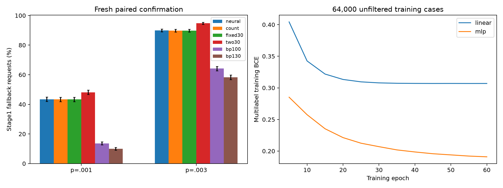

# Approved CPU scaling-selector study

The selector did not establish a corrected fallback-demand gain over fixed BP30 at both noise rates.
Superiority over the cheap count rule at both rates was not established.

This is an auxiliary model-class experiment. Original learned-message evidence remains intact; main M6/E1/E2 and M7 are incomplete.

## Protocol

[32000, 32000] unfiltered training cases by point; 11 factors were executed with actual BP30 decoders (704,000 case-factor outcomes). Logical-success multilabel BCE trained linear and 64/32 ReLU predictors. Inputs were syndrome bits, normalized count and known p. No true faults, observables or decoder outcomes enter inference. Every case receives exactly one selected BP30 pass.

Architecture, checkpoint and switching margin were chosen on reused 42234/42235 validation cases, then hashed and frozen before sampling fresh confirmation sets with seeds [63234, 63235]. Validation performance is development evidence. The oracle union is not an achieved decoder.

## Frozen choices

| p | Predictor | Epoch | Margin | Fixed factor | Count margin |
|---|---|---:|---:|---:|---:|
| 0.001 | linear | 40 | 0.025 | 0.95 | 1 |
| 0.003 | linear | 30 | 0.05 | 1 | 1 |

## Fresh Stage1 outcomes

| p | Method | Fallback requests / shots | Rate | Stage1 logical failures* |
|---|---|---:|---:|---:|
| 0.001 | neural | 1779/4096 | 43.433% | 1779 |
| 0.001 | count | 1774/4096 | 43.311% | 1775 |
| 0.001 | fixed30 | 1774/4096 | 43.311% | 1775 |
| 0.001 | two30 | 1972/4096 | 48.145% | 1972 |
| 0.001 | bp100 | 557/4096 | 13.599% | 557 |
| 0.001 | bp130 | 409/4096 | 9.985% | 409 |
| 0.003 | neural | 3687/4096 | 90.015% | 3689 |
| 0.003 | count | 3677/4096 | 89.771% | 3679 |
| 0.003 | fixed30 | 3677/4096 | 89.771% | 3679 |
| 0.003 | two30 | 3884/4096 | 94.824% | 3884 |
| 0.003 | bp100 | 2629/4096 | 64.185% | 2637 |
| 0.003 | bp130 | 2387/4096 | 58.276% | 2395 |

*Stage1 logical failures include nonconvergence. They are not full-pipeline logical error rates.

| p | Baseline | Baseline fails / neural succeeds | Neural fails / baseline succeeds | Holm p | Clear gain |
|---|---|---:|---:|---:|---|
| 0.001 | fixed30 | 287 | 292 | 1 | False |
| 0.001 | count | 287 | 292 | 1 | False |
| 0.003 | fixed30 | 13 | 23 | 0.529993 | False |
| 0.003 | count | 13 | 23 | 0.529993 | False |

The four neural-vs-fixed/count paired tests form one Holm family. Stronger BP100/BP130 and two-pass comparisons are descriptive challenges.



## Follow-up and limits

The predeclared follow-up gate failed: the selector did not reduce observed fallback requests versus fixed BP30 at both points. No selector full-pipeline accuracy or latency sample was collected. No speed, p99 or LER-equivalence claim follows.

The main final-test seeds 11234–11238 were not used. All work used the pinned local CPU environment, with no new dependency or GPU run.

## Evidence and reproduction

- [Frozen selection](../selection.json)
- [Fresh paired results](../confirmation/summary.json)
- [Training-label audit](../audit-labels.json)
- [Confirmation audit](../audit-confirmation.json)
- [Protocol](../settings.yaml)
- [Training/validation grid](../validation_grid.json)

The first two sequential labeling workers were deliberately interrupted after saving factor .50 to resume the identical computation in six CPU processes. Their KeyboardInterrupt receipts, executed source and completed factor outputs are retained. The label audit regenerates every training input and independently replays 64 cases per factor and p; it does not claim an exhaustive second decoding of all 704,000 outcomes.

```sh
.venv/bin/python scripts/m6_audit_selector.py results/m6_scaling_selector/20261109-approved --phase labels
.venv/bin/python scripts/m6_audit_selector.py results/m6_scaling_selector/20261109-approved --phase confirmation
```

Audits refuse to overwrite receipts; use a copied bundle with the relevant audit receipt removed for replay. Complete rerun instructions are in `docs/m6_scaling_selector.md`.
